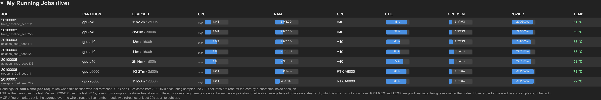
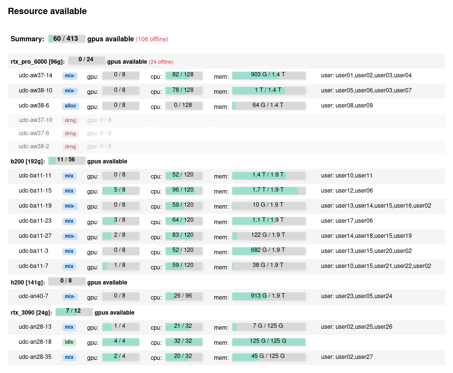
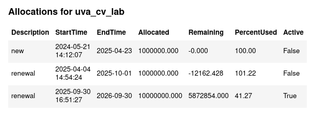
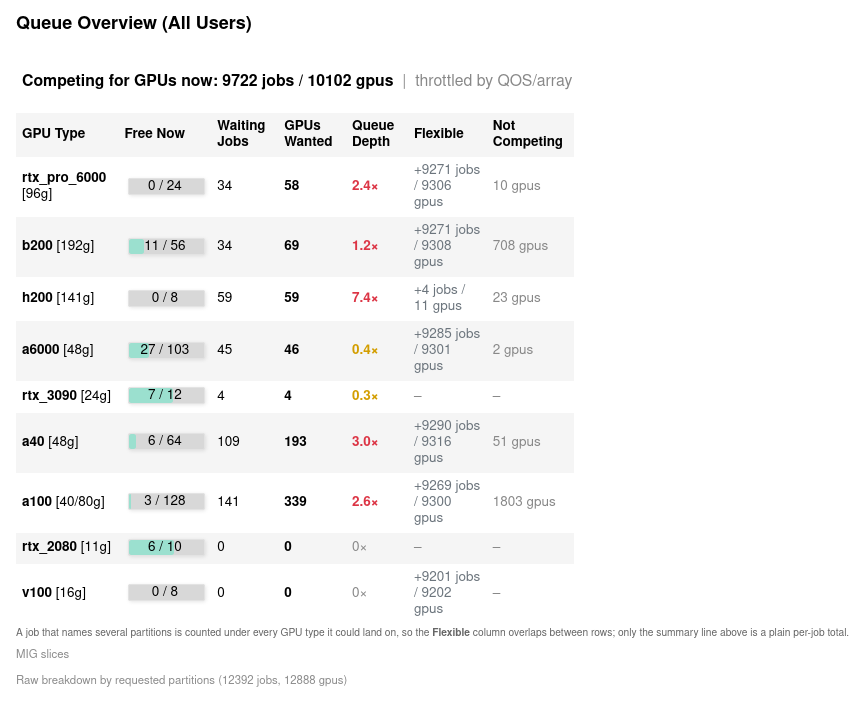
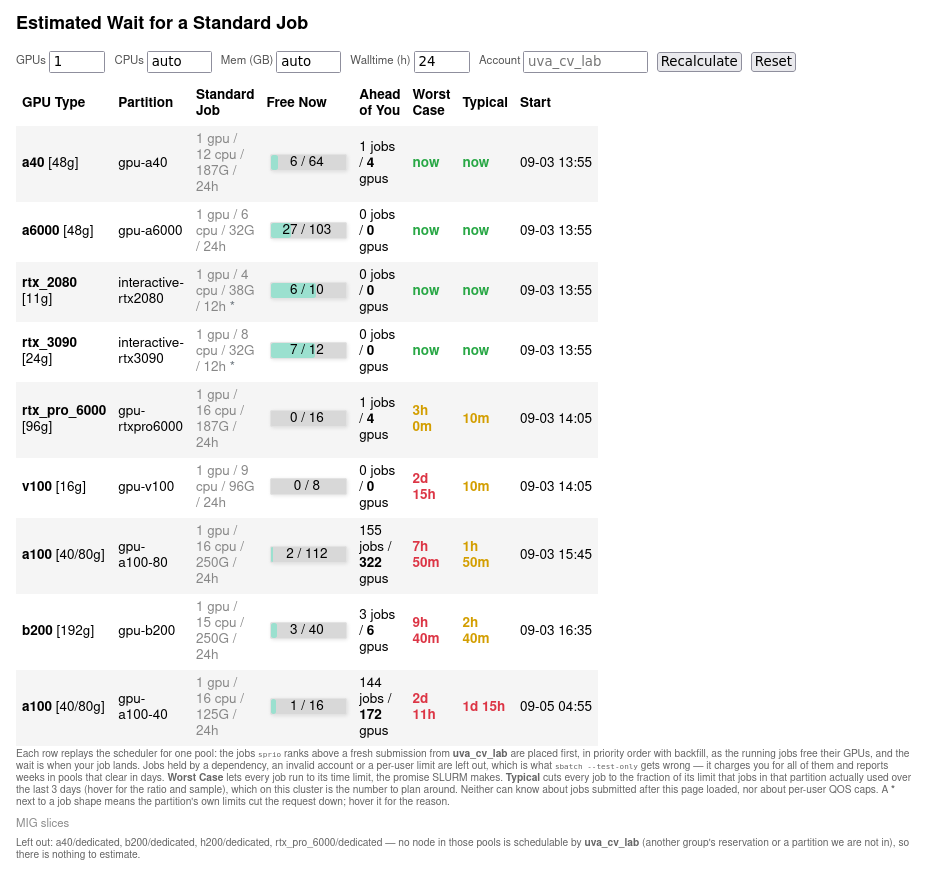
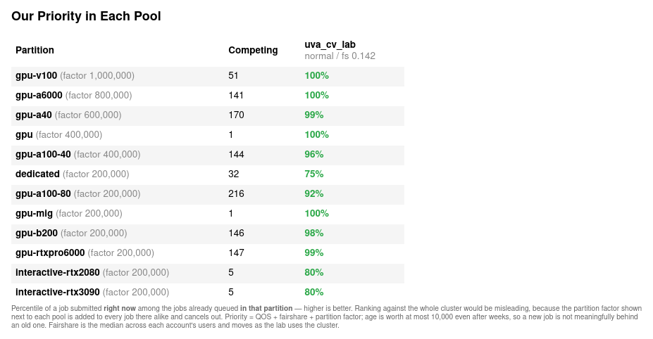

# Panels

[← Back to the README](../readme.md)

Panels are listed in page order. **Scope** says whose data it is: the whole *cluster*,
the *account* picked in the header, or *you*, meaning whoever runs `app.py`.

Everything loads when you open the page, when you come back to its tab, and when you
press *Update All*. Nothing polls in the background.

## My Running Jobs (live)

*Scope: you · Built from `squeue`, `sstat`, `srun`*

What your jobs are really using: busy cores, memory, and per GPU its utilisation, memory,
power and temperature.

- Loads only while the section is open, because each refresh runs a short step inside
  every GPU job (`srun --overlap`).
- One GPU reading swings between 45% and 100% on a steady job, so utilisation and power
  are averaged over samples the driver already buffered (about 5 s and 2.4 s), at no
  extra wait. Hover a bar to see the window.

## Resource available

*Scope: cluster · Built from `sinfo`, `squeue`, `scontrol`*

GPU, CPU and memory of every node, grouped by GPU type, with a state badge (`idle`, `mix`,
`alloc`, `drng`, `resv`) and who is on it. Offline nodes are dimmed. A state ending in
`*` (such as `comp*`) means SLURM cannot reach the node and sends it no new work, so
its GPUs count as offline even when they look free. `comp` means a job on the node is
still cleaning up; SLURM starts nothing there until it is done, which usually takes
seconds but can take hours, so the node counts as offline meanwhile.
Available GPU counts describe unallocated cards. A job must also fit the remaining
CPU and memory on the same node and the available scheduling window.

## GPU Leaderboard

*Scope: cluster · Built from `sinfo`, `squeue`*

Who holds how many GPUs, most first. Your own row is highlighted and marked with `>`.

- `48g`: 48 GB cards · `newer`: anything past the P40/M40 generation · `bash`: held by
  interactive rather than batch jobs.
- Names come from the passwd entry: "Full Name (computing ID)".

## Disk Quota

*Scope: you · Built from `hdquota`*

Size, used and available for your home, scratch and research storage.

## Allocations

*Scope: account · Built from `allocations`*

Service units: allocated, remaining, percent used, and which allocation is active. You
only see balances of accounts you belong to.

## Queue Overview (All Users)

*Scope: cluster · Built from `sinfo`, `squeue`, `scontrol`*

Per GPU type: GPUs free, jobs waiting, GPUs they want, and queue depth.

- Only jobs queued for the monitored GPU partitions count; a job also listing other
  partitions is counted for its monitored ones.
- A job that fits several GPU types is counted under each, so `Flexible` and the
  flexible part of `Not Competing` overlap between rows. Only the summary is unique.
- Candidate types respect Features and requested (`-w`) or excluded (`-x`) nodes.
  Constraints are read when they join features with `&` and `|`, brackets included;
  one using counts, parentheses or negation leaves its job free to use any node, and
  the log names it. A job whose constraint or node lists rule out every node it could
  use counts as `Not Competing`.
- Jobs blocked by a dependency or a QOS/array limit are shown as `Not Competing`.

## Estimated Wait for a Standard Job

*Scope: you under the selected account · Built from `squeue`, `sprio`, `sshare`, `sacct`, `sacctmgr`, `scontrol`,
`sinfo`, `sbatch --test-only`*

"If I submit now, when do I start?" Enter GPUs, CPUs, memory and walltime; each row
models one GPU pool, placing higher-priority work first. Your own fair-share and
submission QoS determine the new job's score, with zero waiting age; for an account you
are not a member of, its members' median fair-share stands in. Memory is in GiB,
matching `sbatch --mem=NG`.

- `Full Limits`: every job runs to its time limit.
- `Historical Runtime`: other jobs run for the share of their time limits, added up,
  that the partition's GPU jobs used over the last 3 days, failed and cancelled ones
  included. Long jobs weigh more than short ones.
- `Model Start`: the resulting estimate, not Slurm's start forecast or a guaranteed bound.
- A running job with no time limit is assumed to keep what it holds for the whole
  30 days the replay looks ahead.
- Feature constraints and requested/excluded nodes restrict placements. Each row assumes
  all eligible higher-priority work uses that pool. Flexible jobs may run elsewhere, so
  small pools can show much longer waits than a job experiences.
  Future arrivals, reservations, priority changes and user or array
  limits can change the result. Waiting Queue shows Slurm's forecasts for submitted jobs.

## Priority in Each Pool

*Scope: you under the selected account · Built from `sprio`, `sshare`, `sacctmgr`, `scontrol`, `sinfo`*

Where a new job by you would rank among competing GPU tasks in each partition.
Ranks are per partition because the partition factor is added to every job in it alike.
Every pending array task counts. Jobs blocked by dependencies or limits do not.
Members of the same account can have different fair-share values. For an account you
are not a member of, its members' median fair-share stands in. Existing jobs keep
their waiting-age bonus, which can decide their order. A percentile compares scores;
it does not establish resource fit or guarantee a position in the scheduler's plan.

## Running Jobs

*Scope: account · Built from `squeue`*

Your account's running jobs with `squeue`'s own columns: how long each has run, its
time limit, the GPUs it holds (`0` for CPU-only jobs), when it started and on which
nodes. The last line totals the account's running jobs and GPUs.
Array jobs show their parent ID and task index. Limits keep minutes, so a 90-minute
allocation reads `1h30m`.

`GPU_TYPE` is the GPU type of the node the job landed on (`-` for CPU-only jobs). A job
sent to a mixed partition such as `gpu` without naming a type shows only `gpu` under
`PARTITION`; this column tells you whether it got, say, an A100 or an RTX PRO 6000.
A100s show their memory in GB, `a100-40` or `a100-80`, read from the node's feature.
`a40/a100` means the job's nodes offer more than one type, so which one it holds cannot
be told from the nodes. `?` means the type could not be looked up: the node list is
missing or was cut off by `squeue`, or a node lists no GPUs.

## Waiting Queue

*Scope: account · Built from `squeue`*

Your account's pending jobs with `squeue`'s own columns. `GPUS` is the total number
of GPUs requested by each job or array task; CPU-only jobs show `0`. `START_TIME` is
SLURM's own estimate and reads N/A for jobs it has not planned, such as held ones.
An array's tasks that have not started share one row, whose `JOBID` shows their range
as `squeue` does (`20478034_[155-742%4]`). The last line totals the account's pending
jobs and the GPUs they request, counting every task of such a row.
Individual array tasks also show the parent and index, even after Slurm gives each an
internal record ID. Time limits retain minutes.
